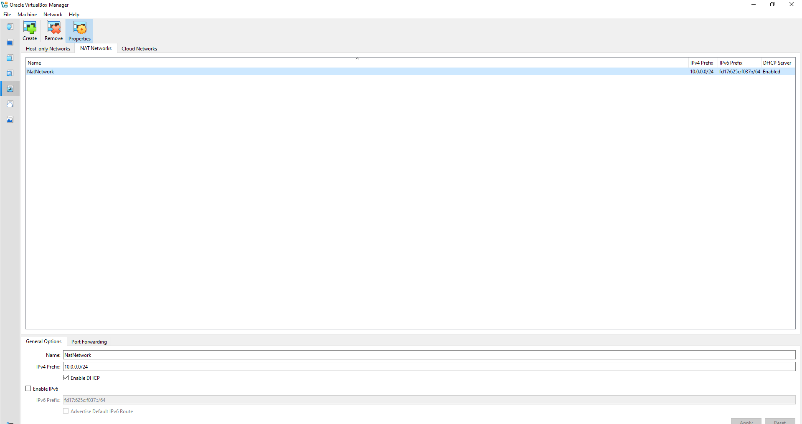
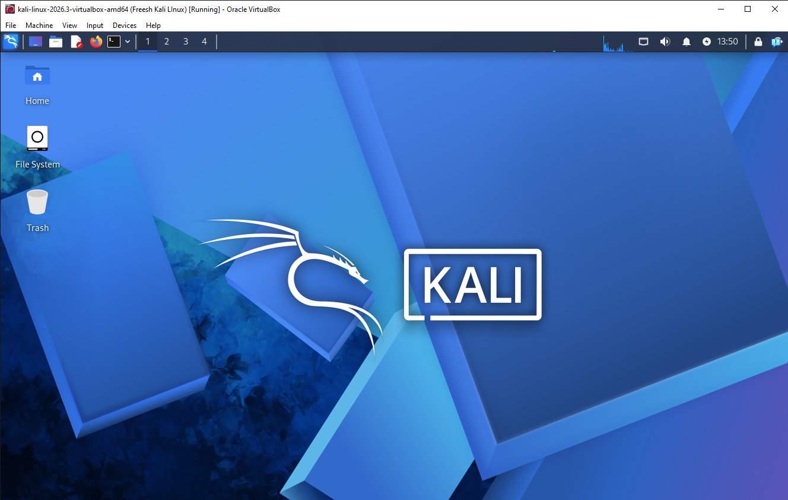
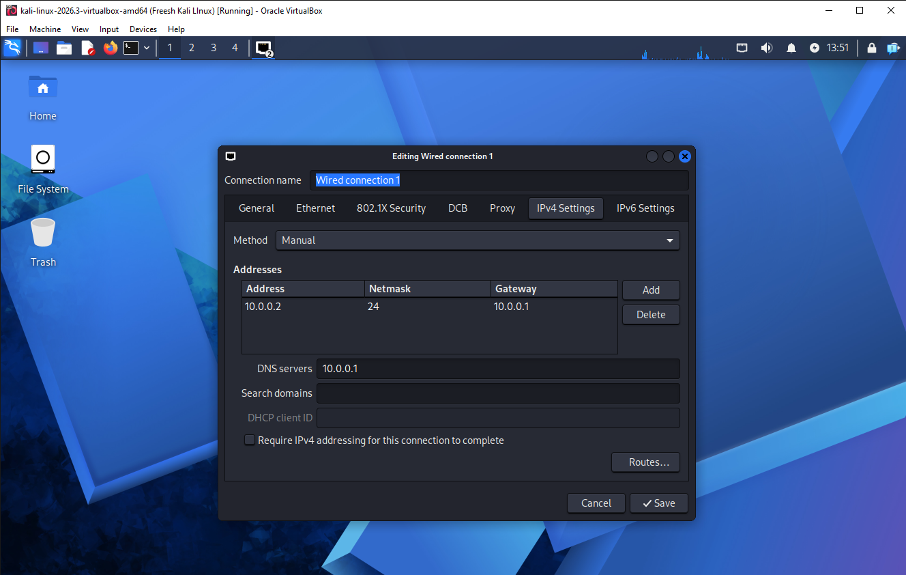

# 🛡️ Virtual Penetration Testing & Security Lab

**Designing an isolated virtual network with VirtualBox and Kali Linux for hands-on offensive security practice**


---

## 📖 Executive Summary

This repository documents the deployment of a self-contained cybersecurity home lab built on **Oracle VirtualBox** and **Kali Linux**. 

The primary goal of this environment is to establish a safe, isolated sandbox for conducting network reconnaissance, vulnerability scanning, packet inspection, and security assessments. By utilizing a private virtual subnet, the lab allows additional vulnerable target machines to be deployed alongside the attacker machine without exposing the host network to unintended traffic.

---

## 🎯 Core Objectives

- Deploy and configure Oracle VirtualBox as the Type-2 hypervisor.
- Import and optimize the official Kali Linux virtual appliance.
- Provision a dedicated **NAT Network** (`10.0.0.0/24`) for inter-VM communication and outbound internet access.
- Assign a persistent IPv4 configuration to the Kali Linux workstation.
- Validate routing, gateway reachability, DNS resolution, and pre-installed security tooling.
- Capture a golden baseline snapshot to allow rapid rollback after testing.
- Maintain comprehensive technical documentation of the build and troubleshooting steps.

---

## 🔬 Intended Use Cases

This virtual sandbox supports practical training across several security domains:
- Host discovery and active network mapping
- TCP/UDP port enumeration and service fingerprinting
- Vulnerability identification and analysis
- Network traffic capture and protocol inspection
- Web application security auditing
- Safe validation of security tools and custom scripts

> **⚠️ Ethical Disclaimer:** All configurations and tools documented in this repository are strictly for educational use and authorized security assessments. Never run reconnaissance or exploitation tools against networks or systems without explicit written permission.

---

## 🖥️ Hardware & Network Specifications

| Parameter | Specification |
| :--- | :--- |
| **Host Operating System** | Windows 10 (64-bit) |
| **Host Memory (RAM)** | 16 GB |
| **Host CPU** | Intel Core i5 |
| **Hypervisor Platform** | Oracle VirtualBox 7.2 |
| **Attacker VM OS** | Kali Linux 2026.2 |
| **Allocated VM Memory** | 2048 MB (2 GB) |
| **Virtual Network Mode** | NAT Network (`NatNetwork`) |
| **Subnet CIDR** | `10.0.0.0/24` |
| **Kali Static IP** | `10.0.0.2/24` |
| **Default Gateway** | `10.0.0.1` |
| **Primary DNS Resolver** | `8.8.8.8` (Google Public DNS) |
| **Reserved Target IP Pool** | `10.0.0.3` – `10.0.0.99` |

---

## 🛠️ Step-by-Step Deployment Guide

### 1. Archive Extraction Utility Setup
Installed **7-Zip** on the host machine to decompress the pre-built Kali Linux `.7z` virtual machine archive without file corruption.

### 2. Hypervisor Installation
Downloaded and installed **Oracle VirtualBox** along with its default virtual networking drivers on the host system.

### 3. Virtual Subnet Creation (NAT Network)
Created a custom **NAT Network** inside VirtualBox Tools -> Network Manager with the following parameters:
- **Network Name:** `NatNetwork`
- **IPv4 Prefix:** `10.0.0.0/24`
- **DHCP Server:** Enabled
- **IPv6 Support:** Disabled

*Why NAT Network?* Unlike standard NAT mode (which isolates each VM behind its own private router), a **NAT Network** places multiple VMs on the same internal Layer-2/Layer-3 switch while translating outbound traffic to the internet. This enables the Kali VM to scan future target VMs on the `10.0.0.0/24` subnet.



### 4. Importing the Kali Linux Appliance
Imported the official Kali Linux VirtualBox image and tuned the hardware profile:
- **Network Adapter 1:** Attached to `NAT Network` (`NatNetwork`)
- **Adapter Hardware Type:** Intel PRO/1000 MT Desktop (`82540EM`)
- **Base Memory:** `2048 MB`
- **Shared Folders:** Configured a host-to-guest shared directory for seamless file exchange.



### 5. Static IPv4 Addressing in Kali Linux
Configured the network interface inside Kali Linux so its IP address remains constant across reboots:
- **IPv4 Address:** `10.0.0.2`
- **Netmask:** `255.255.255.0` (`/24`)
- **Gateway:** `10.0.0.1`
- **DNS Server:** `10.0.0.1`



### 6. Baseline Snapshot Creation
Once network connectivity and system updates were verified, a clean snapshot named **`Baseline - Fresh Network Setup`** was recorded in VirtualBox. Any misconfigurations or system changes during future labs can be reverted to this exact state in seconds.

---

## ✅ Connectivity & Tool Verification

To confirm the lab was ready for operations, the following validation checks were executed inside the Kali terminal:

| Verification Check | Terminal Command | Observed Outcome |
| :--- | :--- | :--- |
| **Interface IP Assignment** | `ip a` | Confirmed `eth0` holds `10.0.0.2/24` |
| **Virtual Gateway Reachability** | `ping -c 4 10.0.0.1` | 0% packet loss from NAT gateway |
| **External WAN Routing** | `ping -c 4 8.8.8.8` | 0% packet loss to external IP |
| **DNS Name Resolution** | `nslookup networkwalks.com` | Successfully resolved domain to IP |
| **Reconnaissance Tool Check** | `nmap --version` | Verified Nmap binary is installed and ready |
| **Snapshot Rollback Test** | Restore snapshot + `ip a` | Confirmed state restores with static IP intact |

---

## 🔧 Troubleshooting Log

### Issue 1: Loss of Outbound Connectivity After Static IP Assignment
- **Symptom:** After switching `Wired connection 1` from DHCP to manual IPv4 settings, outbound pings failed to route properly due to Duplicate Address Detection (DAD) behavior in NetworkManager.
- **Resolution:** Disabled the DAD timeout on the active connection profile via `nmcli` and cycled the interface:
  ```bash
  sudo nmcli connection modify "Wired connection 1" ipv4.dad-timeout 0
  sudo nmcli connection down "Wired connection 1" && sudo nmcli connection up "Wired connection 1"
